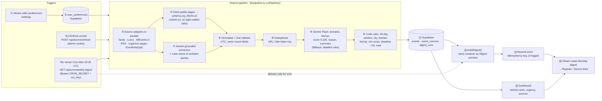

# Industry Event Scout — Components Map

**Case:** MESA Cohort C4 · AI and its Applications · Section 1 — *Industry Event Scout* (Medium)
**User:** Vikram, independent management consultant (≈40 % of new business comes from in-person events)

**How to read this map:** rows are actors/components, columns are process stages. Numbered steps (①–⑮) follow the data from preference setup and source retrieval, through normalisation, rules and AI, to persistence and the Monday email. The manual **Refresh events** button and the scheduled **Monday cron** both enter at step ③ and run the *same* pipeline (`lib/pipeline.ts → runPipeline`); only the trigger and the delivery step differ.

## 1. Actor × stage grid

| Actor / component ↓ · Stage → | 1 Trigger | 2 Input | 3 Context | 4 Processing (code) | 5 AI | 6 Output | 7 Human action |
|---|---|---|---|---|---|---|---|
| **Vikram / preference form** (`/settings`, `app/api/preferences`) | ① Edits domains, cities, formats, email, time zone, digest size | ② Saved preferences (Zod-validated) | | | | | ⑮ Reads digest, opens **Register** / **Source** links |
| **Next.js dashboard** (`app/page.tsx`) | ③a Admin clicks **Refresh events** (`POST /api/events/refresh`) | | | | | ⑬ Ranked cards, urgency badges, filters, source status, “needs verification” tab | Scans/filter list, verifies on source |
| **Vercel Cron** (`vercel.json`, `app/api/cron/weekly-digest`) | ③b Mon 02:30 UTC ≈ 08:00 IST, `Bearer CRON_SECRET` checked | Run key `cron:<Monday>:<prefs>` (idempotency) | | | | | |
| **Source adapters** (`lib/sources/*`) | | ④ Tavily search (queries built from prefs) · Luma city pages · AllEvents.in city pages · RSS/Atom feeds · configured organiser pages · optional Eventbrite API | Retrieval timestamp + source URL on every candidate | Independent `Promise.all`; a failing adapter becomes an `error` status, others continue | | Per-source status (ok / partial / error / disabled) | |
| **Normalisation & dedupe** (`lib/processing/normalize.ts`, `dedupe.ts`, `sources/jsonld.ts`) | | | ⑤ Page fetch (robots.txt honoured, no login-walled sites) → schema.org JSON-LD | ⑥ Build `EventRecord`, validate (Zod), UTC timestamps, never invent fields; ⑧ dedupe by URL, else title + same date + same city; keep all source URLs | | | |
| **Gemini Flash** (`lib/ai/gemini.ts`) | | | Untrusted text wrapped in `<source_data>`; prompt-injection guard | ⑦b Code verifies every AI-extracted date/deadline/URL against a verbatim quote (`ai/grounding.ts`) | ⑦a Grounded extraction from unstructured pages/snippets · ⑨ classify domains & format, relevance 0–100, match reason, summary (JSON schema + Zod) | Assessments labelled as AI opinion; failures → labelled rules-based fallback | |
| **Server-side business rules** (`lib/processing/filter.ts`, `deadline.ts`, `rank.ts`) | | Preferences | Current time, user time zone | ⑩ 30-day window · target city (+aliases) / online policy · domain & format policy · min score · cancelled/closed · **deadline < 7 days ⇒ urgent** · rank (score → urgency → date) | | Buckets: actionable / needs verification / closed / excluded | |
| **Supabase** (`lib/store`, `supabase/migrations`) | | Preferences row | | ⑪ Upsert `events` (by `dedupe_key`), `event_sources` provenance, `digest_runs` with counts, source & AI status | | Run history, stored events re-classified on every read | |
| **Email renderer + Resend** (`lib/email/*`) | | | Same stored events as dashboard | ⑫ `buildDigest` (top N + urgent overflow, HTML-escaped) — also used by `/digest` preview | | ⑭ Resend send (idempotency key = run key); `resend_email_id` logged only on confirmed success | |

## 2. Numbered flow

## 3. Components, status and evidence

Statuses are kept honest: **Implemented** = code exists; **Tested** = verified locally (unit tests or a live local run); **Deployed** only after the Vercel URL is verified.

| Component | Module(s) | Status | Evidence |
|---|---|---|---|
| Preference form + validation | `components/preference-form.tsx`, `app/api/preferences/route.ts`, `lib/validation.ts` | Tested (local) | Saved Bengaluru-only → dashboard dropped to Bengaluru events; invalid time zone rejected with edits kept |
| Luma city-page adapter | `lib/sources/public-page.ts` | Tested (live) | 3/3 pages, 32 structured events in local run on 12 Oct 2026 |
| AllEvents.in city-page adapter | `lib/sources/public-page.ts` | Tested (live) | 9/9 pages, 132 structured events in local run |
| RSS/Atom adapter (Google News search feeds by default) | `lib/sources/rss.ts` | Tested (live) | 3/3 feeds, 44–45 items; items need Gemini to become events |
| Tavily search adapter | `lib/sources/tavily.ts` | Tested (live) | 6 queries → 23–31 unique URLs per run |
| Eventbrite adapter (optional) | `lib/sources/eventbrite.ts` | Implemented — optional, needs token + organiser IDs | Disabled by default |
| JSON-LD extraction, normalisation, validation | `lib/sources/jsonld.ts`, `lib/processing/normalize.ts`, `lib/time.ts` | Tested | `tests/time.test.ts`, live runs |
| Deduplication | `lib/processing/dedupe.ts` | Tested | `tests/dedupe.test.ts` (incl. Bangalore/Bengaluru, separate editions) |
| 30-day window, city/domain/format rules | `lib/processing/filter.ts` | Tested | `tests/filter.test.ts` (boundaries) |
| Deadline < 7 days rule | `lib/processing/deadline.ts` | Tested | `tests/deadline.test.ts` (< 7 d, exactly 7 d, expired, unknown) |
| Ranking + digest selection | `lib/processing/rank.ts` | Tested | `tests/ranking.test.ts` |
| Gemini Flash assessment + grounded extraction | `lib/ai/gemini.ts`, `lib/ai/grounding.ts`, `lib/ai/schemas.ts` | Tested (live + unit) | 10 calls / 0 failures in a live run; `tests/gemini.test.ts`, `tests/grounding.test.ts` |
| Rules-based fallback | `lib/processing/rules-score.ts` | Tested (live) | Labelled “rules” in UI/email when Gemini is unavailable |
| Supabase persistence | `lib/store/index.ts`, `supabase/migrations/…_init.sql` | Implemented — needs project + migration | In-memory fallback (flagged in UI) verified locally |
| Email renderer + preview | `lib/email/render-digest.ts`, `app/digest/page.tsx` | Tested | `tests/digest.test.ts`; preview rendered locally |
| Resend delivery | `lib/email/resend.ts` | Implemented — needs `RESEND_API_KEY` (+ verified domain for arbitrary recipients) | Without key: recorded as not sent, never as success |
| Cron route + idempotency | `app/api/cron/weekly-digest/route.ts`, `lib/jobs.ts`, `vercel.json` | Tested (local) | 401 without/with wrong secret; 2nd call same week → `skipped` |
| Vercel deployment | — | Planned — manual step | See README “Deploy” |

## 4. Why it’s shaped this way

- **AI interprets and explains; code enforces rules.** Gemini scores relevance and writes the reason/summary. The 30-day window, city policy, domain/format policy, deadline urgency, dedupe and ranking are deterministic, unit-tested code.
- **Source data grounds event facts.** Dates, venues, deadlines and links come from schema.org data or from text the model must quote verbatim; code rejects any AI date, deadline, city or URL the quote does not support. Missing deadlines show “Deadline not listed — verify”.
- **One processing pipeline, multiple triggers.** Manual refresh and the Monday cron both call `runPipeline()`; the dashboard, the preview and the email all read the same stored events through `loadCurrentEvents()` and the same `buildDigest()`.
- **Source provenance matters.** Every event keeps its source name, URL and retrieval time (`event_sources`), visible under “Sources” on each card and in the email.
- **Graceful failure.** Each adapter is isolated; a failed source shows an `error` status while others continue. Gemini failures fall back to a labelled rules score; nothing is fabricated.
- **No false delivery status.** A digest counts as sent only when Resend returns an email id; that id is stored in `digest_runs`. A unique run key per Monday prevents duplicate sends on retries.
- **Free-tier first.** Vercel Hobby, Supabase Free, Gemini free tier, Tavily free credits, Resend free plan; Luma/AllEvents/RSS need no key. Caps (queries, pages, AI batches) keep each run within quotas and the function time limit.
